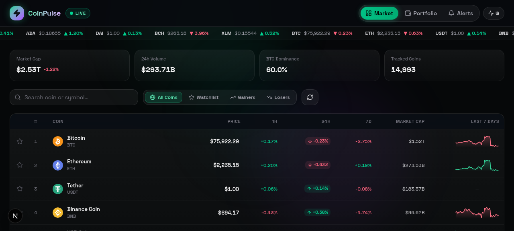

<div align="center">

# ⚡ CoinPulse

**Real-time crypto intelligence — live prices, candlestick charts, portfolio tracking and price alerts in one dark, glassy dashboard.**

Next.js 16 · TypeScript · TradingView lightweight-charts · Prisma (SQLite) · Tailwind CSS 4



</div>

## ✨ Features

| | Feature | Details |
|---|---|---|
| 📈 | **Live market table** | Top 100 coins, price / 1h / 24h / 7d / market cap / volume, auto-refresh every 15 s with green-red **flash animations** on every price change |
| 🕯️ | **Candlestick charts** | TradingView `lightweight-charts`, 5 timeframes (24H / 7D / 30D / 90D / 1Y), per-coin detail page with live stats |
| 📊 | **Sparklines** | 7-day price history rendered per row, cached server-side |
| ⭐ | **Watchlist** | Star any coin — persisted in `localStorage`, one-click filter tab |
| 💼 | **Portfolio P&L** | Add holdings (amount + buy price), see total value, total profit/loss, best performer and an allocation donut — computed against **live prices** |
| 🔔 | **Price alerts** | Create ABOVE/BELOW alerts per coin; a background checker evaluates them against the live feed, fires browser notifications + toasts, and keeps a trigger history with distance-to-target % |
| 🌍 | **Bilingual EN / فارسی** | Full internationalization with automatic **RTL** layout flip for Persian |
| 📱 | **Responsive** | Mobile-first layout, scrolling ticker tape, glassmorphism dark theme |

## 🛠 Tech stack

- **Framework:** Next.js 16 (App Router) + React 19 + TypeScript
- **Styling:** Tailwind CSS 4 + shadcn/ui components, custom glassmorphism theme
- **Charts:** [lightweight-charts](https://github.com/tradingview/lightweight-charts) (candles) + Recharts (allocation donut)
- **State:** Zustand (persisted watchlist / language / device id) + TanStack Query (server state)
- **Database:** Prisma ORM + SQLite — zero-config, file-based
- **Data sources:** [CoinLore API](https://api.coinlore.net/) (markets, global stats) and [Binance public API](https://api.binance.com/) (klines / sparklines) — both proxied and cached server-side, so **the browser never calls the exchanges directly** (this also keeps the app working from networks where Binance is geo-blocked).

## 🚀 Quick start

> Requires **Node.js 20+**. No API keys needed — only public APIs.

```bash
# 1. install dependencies
npm install

# 2. create the SQLite database (tables + file)
npm run db:push

# 3. start the dev server
npm run dev
```

Open **http://localhost:3000** — done. 🎉

<details>
<summary><b>Production build</b></summary>

```bash
npm run build
npm start          # serves on port 3000
```

Deploy easily on **Vercel**: push to GitHub → import the repo → add env var `DATABASE_URL=file:./dev.db` → deploy. (For Vercel serverless, swap SQLite for Turso/Postgres by changing the Prisma `datasource` provider.)

</details>

## 🗂 Project structure

```
src/
├── app/
│   ├── page.tsx                 # single-page shell (views: market / coin / portfolio / alerts)
│   └── api/
│       ├── markets/route.ts     # GET  top-100 coins + global stats   (CoinLore, cached 45 s)
│       ├── sparklines/route.ts  # GET  7-day sparkline series        (Binance, cached 10 min)
│       ├── chart/route.ts       # GET  candlesticks by symbol+range  (Binance, cached 60 s)
│       ├── portfolio/route.ts   # GET/POST/PATCH/DELETE holdings      (Prisma)
│       └── alerts/route.ts      # GET/POST/DELETE alerts              (Prisma)
│           └── check/route.ts   # POST evaluate ACTIVE alerts vs live prices
├── components/coinpulse/       # 15 feature components (table, chart, dialogs, tape…)
├── hooks/                       # useMarkets / useSparklines / useMobile
└── lib/
    ├── market.ts                # upstream fetchers + in-memory TTL cache + dedupe
    ├── store.ts                 # Zustand persisted store
    ├── i18n.ts                  # EN/FA dictionaries (214 lines, RTL-aware)
    └── format.ts                # price/percent formatting helpers
```

## 🧠 Design decisions worth mentioning in an interview

1. **Server-side proxy + TTL cache** — the frontend never hits Binance/CoinLore directly. A tiny in-memory cache (`lib/market.ts`) with request **dedupe** means 100 concurrent users → 1 upstream call per TTL window. It also sidesteps geo-blocks and CORS entirely.
2. **Device-based identity instead of auth** — a `deviceId` UUID is generated per browser and persisted; holdings & alerts are scoped to it. Perfect for a demo: zero signup friction, but the data model (`deviceId` indexed) is ready to become a `userId` FK the day auth is added.
3. **Alert evaluation on the edge of the data** — the client that already receives 15-second market ticks POSTs `/api/alerts/check`; the server compares against the cached price map and flips `ACTIVE → TRIGGERED` atomically, so two open tabs can't double-fire the same alert.
4. **i18n with layout flip** — the dictionary is a flat key-value map; switching to Persian sets `dir="rtl"` on `<html>` and swaps the font to Vazirmatn, while prices stay `dir="ltr"` inside `tabular-nums` cells so numbers never render mirrored.

## 🗺 Roadmap

- [ ] WebSocket stream (Binance `!miniTicker@arr`) for sub-second updates
- [ ] Telegram alert delivery via a bot worker (`python-worker/` ships a ready standalone script)
- [ ] NextAuth — turn `deviceId` into real accounts
- [ ] On-chain wallet tracking (Etherscan / Covalent)

## 📄 License

[MIT](LICENSE) — free to use, fork and showcase.

---

Built as a portfolio project. Data from public APIs — **for demo purposes only, not financial advice.**
